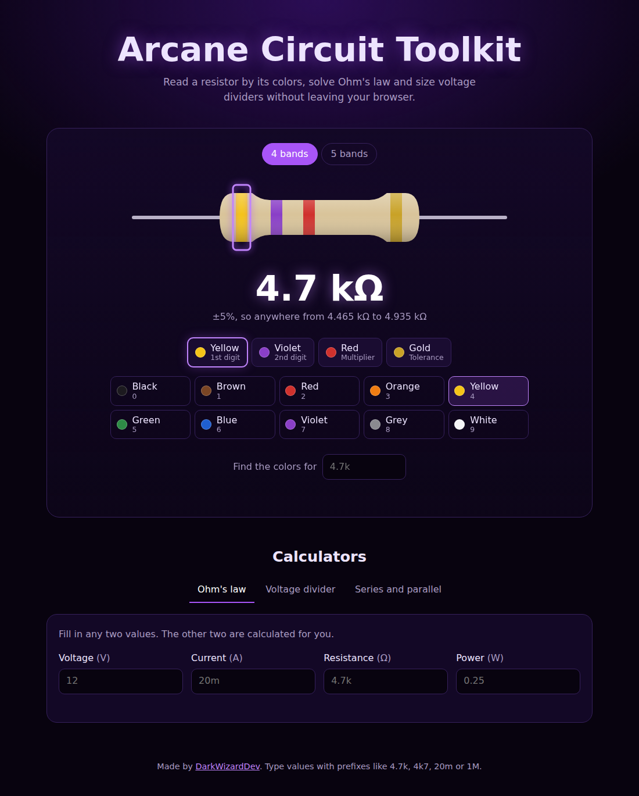

  

  
  
  

<i>Pocket spells for everyday electronics.</i>

  

## ✦ What it does

A small web app for electronics students and makers. Everything runs in the browser, on desktop or phone.

**Resistor color code.** Click the bands of the resistor and pick their colors to read its value and tolerance range. Works with 4-band and 5-band resistors. It also works in reverse: type a value like `4.7k` and it paints the bands for you.

**Ohm's law.** Fill in any two of voltage, current, resistance and power, and the other two are calculated.

**Voltage divider.** Enter the input voltage, R1 and R2 to get the output voltage, the current and the power dissipated in each resistor.

**Series and parallel.** Paste a list of resistors and get the total resistance both ways.

All fields accept engineering prefixes: `4.7k`, `4k7`, `20m`, `1M`, `100u`.

## ✦ Run it locally

No build step and no dependencies. Download the repo and open `index.html` in any browser.

## ✦ Roadmap

- [ ] 6-band resistors (temperature coefficient)
- [ ] Standard E12/E24 value suggestions
- [ ] LED series resistor calculator
- [ ] RC time constant and cutoff frequency

## ✦ License

[MIT](LICENSE) © [DarkWizardDev](https://github.com/DarkWizardDev)

  

